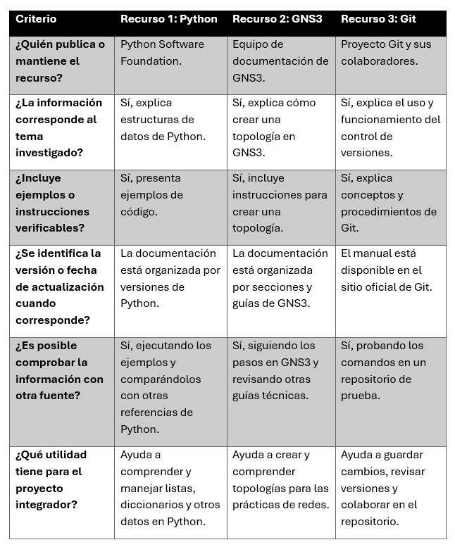
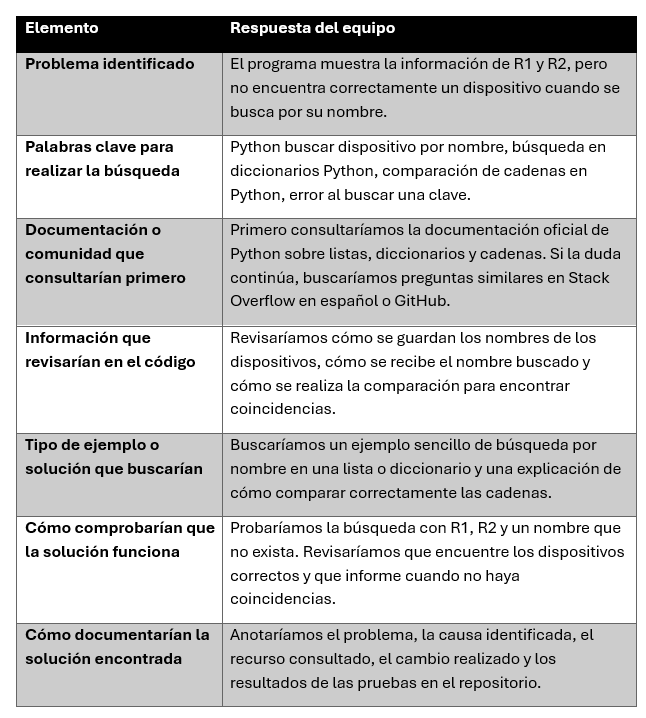

# Práctica 4: Exploración de comunidades, documentación y recursos de colaboración

## 1. Propósito de la práctica

El propósito de esta práctica es conocer diferentes recursos de documentación técnica y comunidades de colaboración que pueden utilizarse para resolver dudas durante el desarrollo de software y las actividades relacionadas con redes.

También se busca aprender a identificar información confiable, seleccionar recursos adecuados para cada problema y documentar los resultados de la investigación dentro del repositorio de GitHub del proyecto integrador.

## 2. Relación con el proyecto integrador

El proyecto integrador está relacionado con la automatización y gestión de infraestructura de red mediante herramientas como Python, GNS3 y Git.

Durante su desarrollo pueden surgir dudas sobre la programación, el almacenamiento de información, la simulación de topologías y el uso de bibliotecas de automatización. Por ello, consultar documentación y comunidades permite investigar posibles soluciones antes de realizar cambios en el código.

Los recursos encontrados se organizaron en archivos Markdown para que los integrantes del equipo puedan consultarlos en futuras prácticas. De esta manera, el repositorio funciona tanto para almacenar los archivos del proyecto como para conservar información útil durante su desarrollo.

## 3. Recursos consultados: síntesis y enlaces

### 3.1. Documentación oficial de Python

**Recurso:** Tutorial de estructuras de datos de Python.

**Enlace:** https://docs.python.org/es/3/tutorial/datastructures.html

Este recurso explica cómo utilizar estructuras de datos como listas, diccionarios, tuplas y conjuntos. Incluye ejemplos que permiten comprender cómo almacenar, organizar, consultar y modificar información.

**Utilidad para el proyecto:** Puede ayudar a comprender cómo organizar los datos de los dispositivos de red y cómo buscar información mediante listas o diccionarios. Por ejemplo, si se necesita localizar un dispositivo por su nombre, conviene revisar cómo se almacenan sus datos y cómo se accede a ellos.

### 3.2. Documentación oficial de GNS3

**Recurso:** Creación de la primera topología en GNS3.

**Enlace:** https://docs.gns3.com/docs/getting-started/your-first-gns3-topology

Esta guía explica cómo crear una topología básica, agregar dispositivos al espacio de trabajo y establecer las conexiones necesarias para comenzar una simulación.

**Utilidad para el proyecto:** Permite consultar procedimientos relacionados con la creación y configuración de topologías. Puede ser útil cuando surjan dudas sobre la organización de los dispositivos o el funcionamiento del entorno de simulación.

## 4. Evaluación de la confiabilidad de los recursos

Para evaluar la confiabilidad de los recursos consultados, revisamos quién publica la información, si corresponde al tema investigado, si incluye ejemplos y qué utilidad puede tener para el proyecto integrador.

### Tabla comparativa de confiabilidad

La siguiente tabla compara tres recursos consultados: la documentación oficial de Python, la documentación de GNS3 y el manual de Git.

### Respuestas de la evaluación

**¿Cuál de los recursos consideras más útil para resolver dudas de Python? ¿Por qué?**

Considero que la documentación oficial de Python es la más útil porque explica cómo funcionan las estructuras de datos e incluye ejemplos que podemos probar para comprender mejor el código.

**¿Cuál consultarías para resolver un problema relacionado con GNS3?**

Consultaría primero la documentación oficial de GNS3, porque contiene guías para utilizar el programa y crear topologías de red.

**¿Por qué no conviene copiar directamente una solución sin comprobar que funciona en el entorno de trabajo?**

Porque la solución podría depender de una versión o configuración diferente. Es importante probarla y comprobar que resuelva el problema sin provocar otros errores.

## 5. Aplicar la investigación a un problema del proyecto

### Problema técnico hipotético

El programa `dispositivos.py`, desarrollado en la Práctica 3, muestra correctamente la información de R1 y R2, pero al intentar buscar un dispositivo por su nombre, el programa no identifica el equipo solicitado.

Como equipo, proponemos una estrategia de investigación para encontrar la posible causa y comprobar una solución.

### Tabla de estrategia de investigación

La siguiente tabla presenta los pasos que seguiríamos para investigar el problema.

### Pasos que seguiríamos para investigar

1. Reproducir el problema y observar qué sucede al buscar un dispositivo.
2. Revisar la parte del código encargada de guardar y buscar los nombres de los dispositivos.
3. Consultar la documentación oficial de Python para comprender el funcionamiento de las estructuras de datos y las comparaciones.
4. Buscar ejemplos relacionados con el problema en comunidades técnicas si la documentación no resuelve la duda.
5. Comparar las posibles soluciones y seleccionar una que corresponda al código utilizado.
6. Probar la solución con los nombres R1 y R2, además de un nombre que no exista.
7. Documentar el problema, la posible causa, los recursos consultados y los resultados de las pruebas en el repositorio.

*Nota: esta sección presenta una estrategia de investigación para un problema hipotético. No significa que el programa se haya modificado o que el problema ya esté resuelto.*

## 6. Aprendizajes obtenidos

Durante esta práctica aprendimos que la documentación técnica ayuda a comprender el funcionamiento de las herramientas que utilizamos en el proyecto integrador. También identificamos que las comunidades de colaboración pueden servir para encontrar ejemplos y conocer otras formas de resolver problemas.

Además, comprendimos que es importante revisar quién publica la información, comprobar los ejemplos y verificar que una solución funcione en nuestro entorno. Organizar los recursos y registrar los resultados en el repositorio facilita que todos los integrantes del equipo puedan consultarlos en futuras prácticas.

## 7. Conclusión individual

Cada integrante debe escribir su nombre y agregar su conclusión individual. La actividad solicita al menos ocho líneas por integrante.

### Conclusión del integrante 1

**Nombre:** [Nombre completo del integrante 1]

En esta práctica aprendí a consultar documentación técnica para resolver dudas.  
Conocí recursos oficiales relacionados con Python, GNS3 y Git.  
Comprendí que cada recurso puede ayudar con problemas diferentes.  
También aprendí que es importante revisar quién publica la información.  
Los ejemplos permiten comprender mejor cómo funcionan las herramientas.  
Antes de aplicar una solución, debemos comprobar que sea adecuada.  
Las comunidades pueden ayudarnos cuando no encontramos una respuesta.  
Considero que organizar estos recursos será útil para las siguientes prácticas.

### Conclusión del integrante 2

**Nombre:** [Nombre completo del integrante 2]

Esta práctica me ayudó a conocer diferentes fuentes de información técnica.  
Aprendí que la documentación oficial puede resolver muchas dudas.  
También comprendí la utilidad de consultar comunidades de programación.  
Es importante revisar si una respuesta corresponde a nuestro problema.  
No debemos copiar código sin entender qué hace.  
Probar las soluciones ayuda a detectar errores antes de continuar.  
Guardar los hallazgos permite compartir información con el equipo.  
Estos conocimientos pueden facilitar el desarrollo del proyecto integrador.

### Conclusión del integrante 3

**Nombre:** [Nombre completo del integrante 3]

Aprendí que investigar un problema requiere seguir varios pasos.  
Primero debemos identificar qué está fallando en el programa.  
Después podemos buscar información en fuentes confiables.  
La documentación de Python y GNS3 ofrece información útil para las prácticas.  
Las comunidades permiten conocer distintas formas de resolver problemas.  
Sin embargo, cada solución debe revisarse y probarse.  
También es importante registrar los resultados en el repositorio.  
Esta práctica nos ayuda a trabajar de forma más organizada como equipo.

## 8. Evidencias

Las siguientes capturas muestran el trabajo realizado durante la práctica. Deben guardarse en la carpeta `docs/practica-04/evidencias/`.

- `01-estructura-repositorio.png`: estructura del repositorio.
- `02-documentacion-python.png`: documentación y recursos de Python.
- `03-recursos-redes.png`: recursos relacionados con redes y GNS3.
- `04-comunidades-colaboracion.png`: comunidades de colaboración consultadas.
- `05-estrategia-busqueda.png`: estrategia de investigación del problema hipotético.
- `06-repositorio-actualizado.png`: repositorio actualizado con los archivos de la práctica.
