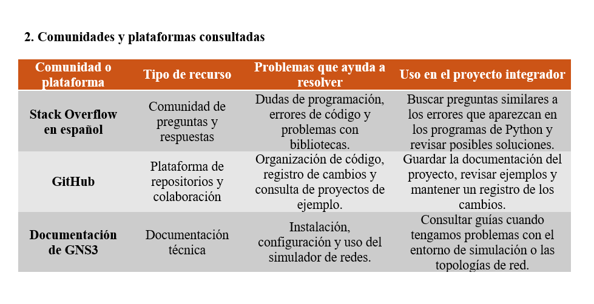

# Comunidades de colaboración

## 1. Propósito

El propósito de este documento es identificar comunidades que pueden ayudar a resolver dudas técnicas y compartir conocimientos relacionados con Python, GitHub y GNS3.

## 2. Comunidades y plataformas consultadas

## 3. Preguntas de análisis

### ¿Qué ventajas tiene consultar una comunidad?

Permite conocer experiencias de otras personas, encontrar problemas parecidos y comparar diferentes maneras de resolver una dificultad. También ayuda a comprender errores que pueden ser difíciles de identificar por cuenta propia.

### ¿Por qué es importante revisar si alguien ya publicó el mismo problema?

Porque puede existir una solución que ya haya sido comprobada. Revisar preguntas anteriores ahorra tiempo y evita publicar consultas repetidas. También permite identificar si la respuesta encontrada corresponde a la versión y al entorno que estamos utilizando.

### ¿Qué información debe incluir una pregunta técnica?

Debe explicar qué se intenta hacer, qué resultado se esperaba, qué ocurrió realmente, qué versión de las herramientas se utiliza y qué pasos se siguieron. Cuando sea necesario, puede incluir un fragmento pequeño de código y el mensaje de error completo.

### ¿Por qué conviene describir los intentos y errores anteriores?

Porque ayuda a que otras personas comprendan el problema y evita sugerencias que ya se probaron sin éxito. Además, permite identificar en qué paso aparece la dificultad.

### ¿Cómo debemos comportarnos en una comunidad técnica?

Debemos escribir con respeto, explicar el problema con claridad, agradecer la ayuda y comprobar las soluciones antes de recomendarlas. También es importante reconocer el trabajo de otras personas, respetar las licencias y evitar publicar contraseñas, datos privados o información sensible.

## 4. Conclusión

Las comunidades técnicas son útiles para aprender, compartir experiencias y resolver problemas. Sin embargo, sus respuestas deben revisarse y probarse antes de aplicarse al proyecto. Una buena consulta debe incluir información suficiente para que otras personas puedan comprender y reproducir el problema.